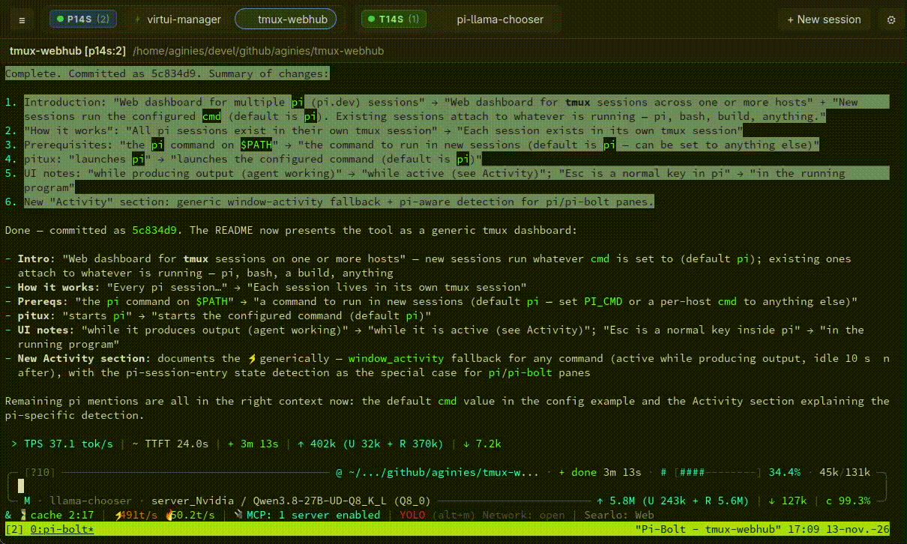

# tmux-webhub

Web dashboard for **tmux** sessions on one or more hosts. Browse every session
grouped by host, click to attach, type, resize — the session keeps running in
tmux when you detach. New sessions run whatever `cmd` is set to (default `pi`);
existing ones attach to whatever is already running in them — pi, bash, a build,
anything.



- **Two-factor + token auth** — TLS by default; one access token gates the
  page, the API and the WebSocket; optional TOTP two-factor (scan a QR at first
  login) — from then on every login needs token + code, and wrong attempts are
  rate-limited.
- **Use it from a smartphone** — mobile layout, an on-screen virtual keyboard
  (special keys + full QWERTY page, Shift/Ctrl/Alt with hold-to-lock) sent
  through `tmux send-keys`, Esc / PgUp / PgDn buttons, two-finger scrollback.
  No hardware keyboard needed.
- **Add/remove hosts in the browser** — ⚙ → *Hosts*: "+ Add host", edit name /
  `ssh` / `cmd`, toggle a host on/off, reorder, ✕ to remove. Local hosts and
  remote ones over SSH (e.g. `aginies@192.168.1.50`) sit in one view; the list
  is live-reloaded — no restart.
- **Sessions appear by themselves** — every host is polled (default 5 s) and
  its tmux sessions show up grouped by host with a live activity indicator; a
  session started on any host appears on its own, nothing to sync.
- **Pick the network interface easily** — the bind field in ⚙ suggests
  `0.0.0.0` plus every real address of the server, so choosing the right
  interface is a click, not an `ip addr` hunt.
- **Attach any session** — click a session in the list and you're in. Type,
  resize, scroll the scrollback — it's a full terminal. Close the tab and the
  session keeps running in tmux.
- **pi / pi-bolt activity** — the ⚡ says "doing something right now". For most
  programs it follows tmux output; for pi panes it reads pi's own state, so a
  settled pi is never shown as active just because its TUI redrew.
- **Network readout** — the header shows live bandwidth usage (5 s average), or
  is off entirely.

## Install

### 1. Install the server

```sh
npm install -g tmux-webhub
```

Or from a git checkout:

```sh
git clone https://github.com/aginies/tmux-webhub && cd tmux-webhub
npm install   # builds node-pty (a native module — prebuilt on common platforms)
```

This installs the `tmux-webhub` server command and the `pitux` helper.

### 2. Create a config file

The server reads `config.json` from the **directory you start it in** (override
with the `PC_CONFIG_FILE` env var). So with a global install, run it from the
directory where you put the config:

```sh
mkdir -p ~/.tmux-webhub && cd ~/.tmux-webhub
cp /usr/local/share/tmux-webhub/config.example.json ./config.json
# then edit: set a token, add your hosts
```

### 3. Configure

At minimum, set a **token** (the access password) and list your **hosts**.
Every field is documented in [docs/CONFIG.md](docs/CONFIG.md); a quick example:

```json
{
  "port": 8787,
  "token": "paste-an-openssl-rand-hex-32-here",
  "tls": true,
  "hosts": [
    { "name": "localhost" },
    { "name": "station2", "ssh": "aginies@192.168.1.50" }
  ]
}
```

- A host with no `ssh` runs commands **locally**. A host with `ssh` reaches
  **remote** machines over SSH, using the daemon user's SSH identity (their keys
  or agent), key auth only — so make sure `~/.ssh/known_hosts` has each host
  key.
- `cmd` is the command started in new sessions (default `pi`); set `PI_CMD` or a
  per-host `cmd` to anything else (`pi-bolt`, `htop`, `bash`).

### 4. Run it

```sh
tmux-webhub        # or: node server.js   (from the config directory)
```

On first start a self-signed TLS cert is generated in `.certs/`; the browser
shows a one-time "insecure connection" interstitial — accept it.

Then open **https://<host>:8787** in a browser and enter the token from
`config.json`. The cookie keeps you logged in for 30 days; ⚙ → *Log out* to sign
out (with 2FA enrolled, that also deletes the session server-side).

**Two-factor (TOTP).** Set `"twoFA": "required"` (or `"optional"`) in
`config.json` and restart. The first login enrolls it: scan the QR code with any
authenticator app (or type the base32 secret), confirm with a 6-digit code. From
then on every login needs **token + code**, and the raw token alone no longer
grants access anywhere (page, API, WebSocket). Wrong codes share the token rate
limit. Disable it from ⚙ → *two-factor* with a fresh code (the phone must be in
hand); if the phone is lost, delete the `totp` key in `config.json`. The full
model — TLS, cookies, CSRF, rate limiting — is in
[docs/SECURITY.md](docs/SECURITY.md).

**Prereqs:** `node` (with `node-pty` built), `tmux`, `openssl`.

## Create a session

- **Web:** **"+New"** → pick host, tmux name, working directory (it
  autocompletes: click a subdirectory to descend, `.` for dot-dirs, empty = the
  host's home). The command started is the host's `cmd` (default `pi`).
- **Terminal (local):** `pitux new <name> [cwd]` starts a detached session and
  attaches, `pitux <name>` attaches to an existing one, `pitux ls` lists.
  Session names start with a letter/digit and contain only letters, digits,
  `.` `_` `-`.

## Use from a smartphone

Everything works on a phone, no hardware keyboard needed:

- **Virtual keyboard (⌨)** — the ⌨ button opens a draggable, resizable
  on-screen panel. *special* page: Tab, Enter, Ctrl+C, Alt+↑, arrows,
  PgUp/PgDn, …; *abc* page: Esc, F1–F10, digits, full QWERTY, and Shift /
  Ctrl / Alt — hold a modifier 2 s to lock it, tap it again to unlock. Every key
  goes out through `tmux send-keys`, exactly like a keystroke on the host.
- **⎋ / Pg↑ / Pg↓** — Esc, PageUp and PageDown buttons in the header, covering
  the desktop keyboard's jobs: quit a TUI, scroll the scrollback.
- **Two-finger scroll** — drag with two fingers to scroll the scrollback; one
  finger is reserved for typing.
- Touch targets are sized for fingers, inputs don't trigger iOS auto-zoom, and
  modals open as bottom sheets above the phone's own keyboard.

## Stop / restart / daemonize

- **Stop:** `Ctrl+C`, or `pkill -f 'node server.js'`.
- **Restart** with new server settings: stop, edit `config.json` (or the ⚙
  editor), start again.
- **Keep it alive** without a terminal:
  ```sh
  setsid nohup node server.js >> tmux-webhub.log 2>&1 &
  ```
  or with a systemd **user** unit (the repo ships `deploy/tmux-webhub.service`):
  ```sh
  mkdir -p ~/.config/systemd/user
  cp deploy/tmux-webhub.service ~/.config/systemd/user/
  $EDITOR ~/.config/systemd/user/tmux-webhub.service   # set WorkingDirectory
  systemctl --user daemon-reload
  systemctl --user enable --now tmux-webhub
  loginctl enable-linger $USER    # start at boot, survive logout
  journalctl --user -u tmux-webhub -f   # logs
  ```

## Config editor

The ⚙ button opens a modal to edit `config.json` in the browser. The write is
atomic and JSON-validated, so a broken file can never be saved.

- **Hosts** — "+ Add host" appends a row; each row has `name`, `ssh`
  (`user@host`, empty = local), `cmd`, and an on/off switch; ↑/↓ reorder, ✕
  removes. The host list is **live-reloaded** — a new host starts being polled
  immediately, no restart.
- **Bind address** — the `host` field offers `0.0.0.0` plus every real address
  of the server (fetched live from it), so picking the right network interface
  is a click.
- **Token** — always masked; typing a new value replaces it.
- **Two-factor** — shows the enrollment state; disable with a fresh 6-digit
  code.
- **Log out** — ends this browser's session (with 2FA: deleted server-side).

The host list and per-host `cmd` apply immediately; server settings (`port`,
`token`, `tls`, `cert`, `key`, `pollMs`, `netDisplay`, `twoFA`) need a
restart.

## Environment variables

Override the config file for deployment-time settings:

| var | meaning |
|---|---|
| `PC_PORT` | listen port |
| `PC_HOST` | bind address |
| `PC_TOKEN` | access token (empty = auth disabled, dev mode) |
| `PC_TLS` | only the literal value `false` disables TLS (anything else = https) |
| `PI_CMD` | command started in new sessions (default `pi`) |
| `PC_CONFIG_FILE` | config file path (default `./config.json`) |

## Technical detail

The overview above is enough to run it. For how it works under the hood, the
full config reference, and the security model, see the docs:

- **[docs/CONFIG.md](docs/CONFIG.md)** — every config field, env var, the
  `pitux` helper, and daemonizing.
- **[docs/ARCHITECTURE.md](docs/ARCHITECTURE.md)** — how attaching, the
  session poller, SSH connection pooling, backpressure, the network readout, and
  pi activity work.
- **[docs/SECURITY.md](docs/SECURITY.md)** — the full security model (TLS, token
  auth, TOTP two-factor, CSRF, rate limiting, session cookies).
